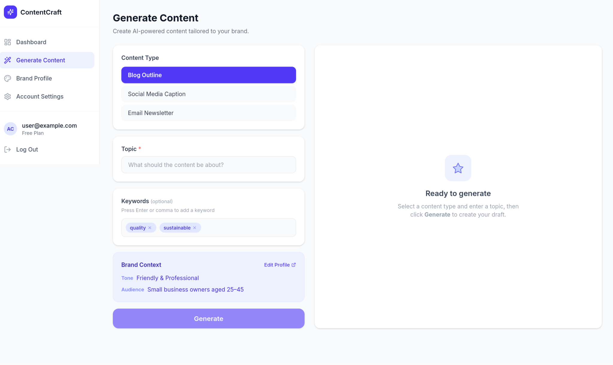

This is a [Next.js](https://nextjs.org) project bootstrapped with [`create-next-app`](https://nextjs.org/docs/app/api-reference/cli/create-next-app).

## Getting Started

First, run the development server:

```bash
npm run dev
# or
yarn dev
# or
pnpm dev
# or
bun dev
```

Open [http://localhost:3000](http://localhost:3000) with your browser to see the result.

You can start editing the page by modifying `app/page.tsx`. The page auto-updates as you edit the file.

This project uses [`next/font`](https://nextjs.org/docs/app/building-your-application/optimizing/fonts) to automatically optimize and load [Geist](https://vercel.com/font), a new font family for Vercel.

## Learn More

To learn more about Next.js, take a look at the following resources:

- [Next.js Documentation](https://nextjs.org/docs) - learn about Next.js features and API.
- [Learn Next.js](https://nextjs.org/learn) - an interactive Next.js tutorial.

You can check out [the Next.js GitHub repository](https://github.com/vercel/next.js) - your feedback and contributions are welcome!

## Deploy on Vercel

The easiest way to deploy your Next.js app is to use the [Vercel Platform](https://vercel.com/new?utm_medium=default-template&filter=next.js&utm_source=create-next-app&utm_campaign=create-next-app-readme) from the creators of Next.js.

Check out our [Next.js deployment documentation](https://nextjs.org/docs/app/building-your-application/deploying) for more details.
# ContentCraft

ContentCraft writes marketing copy for a small business.

The owner fills in a brand profile once - business name, industry, audience and tone - then asks for a blog outline, a social caption or an email newsletter.
Each draft comes back scored on five measures, so the owner can see what is weak before they publish it.



Capstone project for NIT3003 and NIT3004 at Victoria University.
The proposal and the design are written and marked.
The application is built and runs against a live database.
There is no public deployment yet.

## What it does

- A brand profile per business, with one account kept apart from every other by the database.
- Three content types: blog outline, social media caption and email newsletter.
- Generation through Gemini, capped at twenty drafts a month, with one generation at a time per account.
- An editor with copy, a star rating, and mark ready or discard.
- A quality report on every draft: readability, tone, keyword coverage, structure and the owner's satisfaction, weighted into one score, with the reason behind each failed check.
- A monthly usage figure and an estimated cost, priced from a table rather than a number in the code.

## Stack

| Layer | Choice | Why |
|---|---|---|
| Application | Next.js 16, React 19, TypeScript, Tailwind 4 | one deployable, server rendering by default |
| Data and login | Supabase: Postgres, auth, row level security | tenancy enforced by the database instead of by every query |
| Generation | Gemini, behind a provider port | the vendor is configuration, and the build has already outlived one |
| Command line tools | Go, standard library only | the evaluation and tenancy probes are small and need no dependencies |

## Run it

Node 20.9 or newer, and pnpm.

```bash
cd web
pnpm install
cp .env.local.example .env.local
pnpm dev
```

`http://localhost:3000/preview` renders every component with fake data.
It needs no database, no keys and no login, so it is the fastest way to see the interface.

Every other route needs a Supabase project and a Gemini key.
`web/README.md` lists each variable and what happens without it.

## Checks

```bash
cd web && pnpm check
cd tools/evaluation && go test ./...
cd tools/tenancy && go test ./...
```

`pnpm check` runs the type check, the lint and the test suite.
There is no CI, so it runs on the machine before a pull request.

## Where everything else lives

| Path | What is there |
|---|---|
| `web/` | the application, with its own README covering routes, variables and the database |
| `docs/sections/` | the proposal, fourteen numbered sections, rebuilt with `make docx` |
| `docs/design/` | the architecture, the evaluation experiment and the answer to the instructor's feedback |
| `docs/plan/` | the board, the card briefs, the working agreements and the tenancy check |
| `docs/diary/` | the progress diary, one folder per person |
| `tools/evaluation/` | the Go program behind the evaluation experiment |
| `tools/tenancy/` | the Go probe that proves the isolation rules on any project |
| `scrub.py`, `.githooks/` | the pre-commit scan for secrets and personal data |

## Status

Working: accounts and login, the brand profile, generation for all three content types, the editor, the dashboard, the quality score and the monthly cost.

The database exists with the schema applied, and the isolation rules were verified on the live project with two accounts: an unfiltered read returns one row each, nothing comes back without a token, a cross-tenant insert is refused with 403, and a cross-tenant update changes nothing.
`docs/plan/tenancy-check.md` records the run and what it did not cover.

Still open, tracked in `docs/plan/build-plan.md`:

- A deployment. There is no public URL yet, so nothing in this repository is proven end to end on a public host.
- An API key for generation on a deployed build.
- The evaluation experiment: drafts rated by people outside the build, and an agreement statistic against the computed score.
- A load test against the non-functional requirements, seven of which are honestly unmeasured.

## Ownership

Coursework for NIT3003 and NIT3004 at Victoria University, by Hailu Tesfaye Seyoum, Jamal Hussein, Semir Abdu and Daniel Palazzolo.
No licence is granted; this is submitted coursework, not a product released for reuse.
