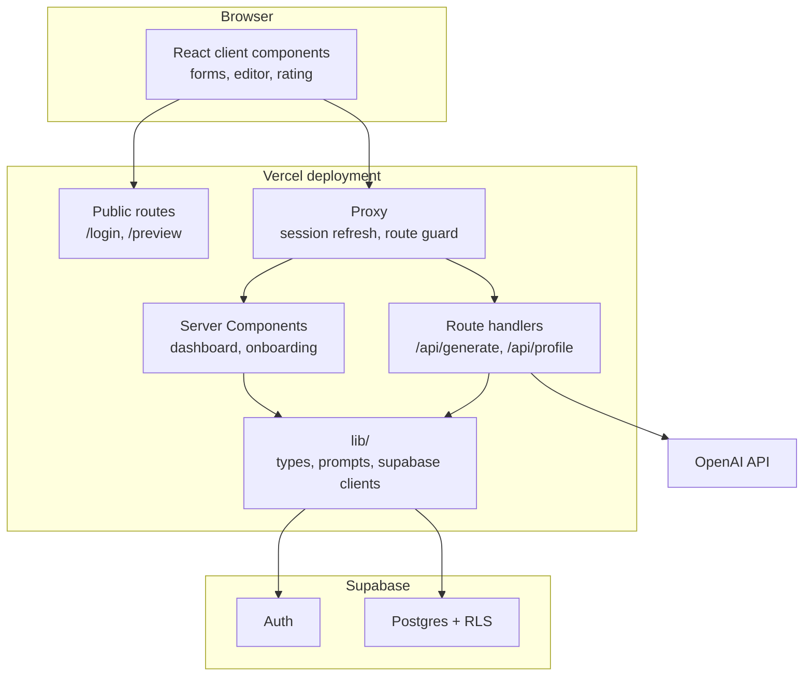

# System Architecture

Source of truth for the design decisions behind the ContentCraft build.
The marked document (`docs/sections/05-sequence-diagrams.md`) summarises this and must not contradict it.

---

## 1. Shape of the system

One application. One repository. One database.

```
Browser  ->  Next.js on Vercel  ->  Supabase (Postgres, Auth, RLS)
                    |
                    +------------>  OpenAI API
            (server side only)
```

The whole system is a **modular monolith** deployed as a single Vercel application, with the tenancy boundary enforced in the database rather than in routing.

The justification is scale, not preference.
Four developers, one of whom carries the build.
A prototype that must demonstrate 80 percent completion in a single semester.
On that budget, every additional deployable unit, network hop and operational dependency is a liability with no return.

## 2. Component view



The `lib/` module is the only place that knows about Supabase or prompt construction.
Nothing else imports either SDK directly, with one exception noted in section 5.

## 3. Pattern catalogue

Each pattern is listed with the reason it earns its place, and the alternative it replaced.

### 3.1 Modular monolith

A single deployable with internal module boundaries.

Rejected: microservices, separate frontend and API deployments.
The Non-Functional Requirements promise a queue above 100 requests per minute and 99.9 percent business-hours uptime.
Neither is achievable on free-tier infrastructure, and splitting the system into services would add network failure modes and deployment coordination to a team of four.
The module boundaries inside `lib/`, `components/` and `app/` give the same separation of concerns without the operational cost.

### 3.2 Server-first rendering, client boundary at the leaves

React Server Components are the default.
`"use client"` is applied only to components that hold state or handle events.

In the current code the four delegated components are client components because they need `onChange` and `onClick`.
Pages remain server-side.

Rejected: client-side data fetching with a global store.
Server-first rendering removes the initial loading state, keeps database access on the server, and means the browser needs no database credential.

### 3.3 Backend for Frontend

`app/api/*` route handlers are the only surface the browser may call.
They are also the only place `OPENAI_API_KEY` exists.

This resolves an inconsistency in the previous proposal, where the sequence diagram had the frontend reading Supabase directly while the pseudocode placed prompt assembly on the server.
The server wins.
The browser does not communicate with Supabase at all in this design.

### 3.4 Pooled multi-tenancy with row-level security

A tenant is a small business, which maps to a user account.
Every row carries `user_id`, and Postgres policies enforce `auth.uid() = user_id` for select, insert, update and delete.

| Tenancy model | Decision |
|---|---|
| Database per tenant | Rejected. Provisioning and migration cost multiplies by tenant count. Wrong at prototype scale. |
| Schema per tenant | Rejected. Same multiplicative cost, plus schema switching in every query. |
| **Shared schema with row-level security** | **Selected.** One migration path, one connection pool, isolation enforced by the database rather than by application code. |

The `with check (auth.uid() = user_id)` clause on insert is the load-bearing half.
An application bug that fails to set `user_id` is rejected by the database instead of writing a row into another business's account.
The API layer validates and the database refuses regardless, which is defence in depth rather than a single point of failure.

Next.js documents a subdomain-routing approach to multi-tenancy.
That model targets a different problem, where each customer receives a workspace hostname.
Applying it here would be over-engineering.

### 3.5 Errors as values

`Result<T, E>` is a discriminated union defined in `lib/types.ts`.
Callers narrow on `ok` and the compiler requires both branches to be handled.

Rejected: thrown exceptions crossing module boundaries.
An exception can be swallowed by a `catch` several frames from its origin.
A return value cannot.
Since the acceptance criteria specify error behaviour, that behaviour is encoded in the type rather than left to convention.

### 3.6 Closed sets as sum types, mirrored as database enums

`ContentType` is `blog_outline | social_caption | email_newsletter`, not `string`.
The same three values exist as a Postgres enum type in `supabase/schema.sql`.

An invalid content type is therefore a compile error in TypeScript, a validation failure at the API boundary, and a constraint violation in the database.
Three enforcement layers, one definition.

### 3.7 Ports at the external boundaries

`lib/supabase/server.ts` and `lib/supabase/client.ts` are the only modules that import the Supabase SDK.
`lib/prompts.ts` is the only module that builds prompt text.

Replacing the model provider, or leaving Supabase, touches a small number of files.
This is hexagonal architecture applied only where a real alternative exists, not applied uniformly for symmetry.

### 3.8 Contract-first components

Every delegated component has its props type defined before its body, and its parent already passes real data.
For example, `ProfileForm` accepts `onSave: (form: FormData) => Promise<Result<null>>`.

The component owner cannot invent a different shape, because the shape is fixed and already in use.
Their task is markup inside a boundary they did not have to design.

This is the ports concept applied to people rather than to I/O, and given the team's capability distribution it matters more than any other pattern here.

### 3.9 Stateless requests with cookie sessions

The session token lives in HTTP-only cookies and is refreshed in `proxy.ts`.
There is no server-side session store, so any instance can serve any request.

This is what allows the Vercel deployment to work without sticky sessions, at no cost.

### 3.10 Validation at the boundary only

`isContentType` and `isBrandTone` in `lib/types.ts` are called once, at the edge of the route handler.
After that conversion the code trusts the types.

Downstream there are no truthiness guards and no optional chaining on already-parsed data.
One conversion point, then the type system carries the invariant.

`parseContentType`, `parseBrandTone`, `parseRating` and `parseGenerationRequest` are the boundary parsers.
Each returns a `Result`, so a malformed request produces a value the caller must handle rather than a thrown exception.

### 3.11 An invariant layer instead of non-null assertions

`lib/assert.ts` provides `invariant`, which narrows types through TypeScript's `asserts` signature and throws `InvariantError` when a condition fails.
`lib/env.ts` builds on it to replace the non-null assertions that were previously used on environment variables.

```ts
process.env.NEXT_PUBLIC_SUPABASE_URL!   // before: undefined at runtime
requireEnv("NEXT_PUBLIC_SUPABASE_URL")  // after: MissingEnvError naming the variable
```

The distinction between an invariant and a `Result` is deliberate, because the two are not interchangeable.
A `Result` covers an expected failure the caller can branch on, such as a malformed request or an upstream timeout.
An invariant covers a condition that cannot hold if the program is correct, such as a metric outside its range or a missing deployment variable.
When an invariant fails there is no recovery path, so execution stops with a message naming the condition instead of continuing with a bad value.

Assertions sit where a violation is possible: the proxy, the environment loader, the Supabase clients, the scoring functions and the rating control.
Pure presentational components have none, because they hold no state that can violate anything.

Rejected: a dedicated assertion library, and an error type per subsystem.
`InvariantError` and `MissingEnvError` are the only two error types, and both carry the offending detail as a field.

### 3.12 Determinism and the generation record

Model output is not reproducible, because generation runs at a non-zero temperature.
Requirements that depend on comparing generations therefore depend on recording what produced each one.

Every row in `generated_content` stores the model, the temperature, the system prompt and the user prompt alongside the content and its scores.
The full prompt text is stored rather than a hash, because the evaluation work needs to inspect what was actually sent.

This follows from the principle that a result that cannot be reproduced cannot be defended.
The cost is four columns now against a migration later.

## 4. Rejected approaches

Recorded so the decision is visible as a decision rather than an omission.

| Approach | Why it was rejected |
|---|---|
| Microservices | No team capacity or operational budget. Adds failure modes. |
| CQRS, event sourcing | No audit or replay requirement exists. |
| Message queue | Required only if the throughput NFRs are kept. See section 5. |
| Repository pattern per entity | The Supabase client is the repository. A wrapper with a single implementation is cost without return. |
| Redux or a global store | Server Components fetch and `useState` holds form state. Nothing else is shared. |
| Full hexagonal layering | Four layers of indirection for a six-feature prototype. |
| Domain model classes | The domain is two tables and one enum. |
| Subdomain-per-tenant routing | Targets a different multi-tenancy problem. |
| Hosted Postgres without Supabase | Postgres alone is not simpler, because it removes authentication, which is the largest and most security-sensitive component of the build. It would also require either plumbing the user identity into every query or reimplementing row-level security. Evaluated and rejected. |

## 5. Known gaps

Open items, recorded honestly.

**Double submission on generate.**
The brief specifies one generation per user at a time.
The current design allows a double-click to post twice, creating two drafts and two billable model calls.
The fix is a client-supplied request identifier with a unique constraint on the drafts table.

**`proxy.ts` imports the Supabase SDK directly.**
It is the single exception to the ports boundary in section 3.7.
The proxy runs separately from render code and cannot import shared modules, so the duplication is accepted.

**The Non-Functional Requirements promise capability the architecture does not have.**
The queue above 100 requests per minute, the 99.9 percent uptime target and 50 concurrent users are unmeasured and unsupported by the current deployment.
Either the design gains a caching and queueing story, or the requirements are revised to measured values.
Leaving an unsupported promise in the report repeats the weakness already identified in the proposal review.

**Free tier pausing.**
Supabase pauses a Free plan project after 7 days without activity, and restoring it is a manual dashboard action.
The project must be woken and exercised in the week before the demonstration.
The dashboard shows a last-activity indicator.
Alternatively, one month of the Pro plan can be purchased around the demonstration date and cancelled afterwards.

**Evaluation is designed but not implemented.**
The five-metric quality rubric appears in the pseudocode and has no corresponding component in this design.
It is scheduled after the demonstration build.
