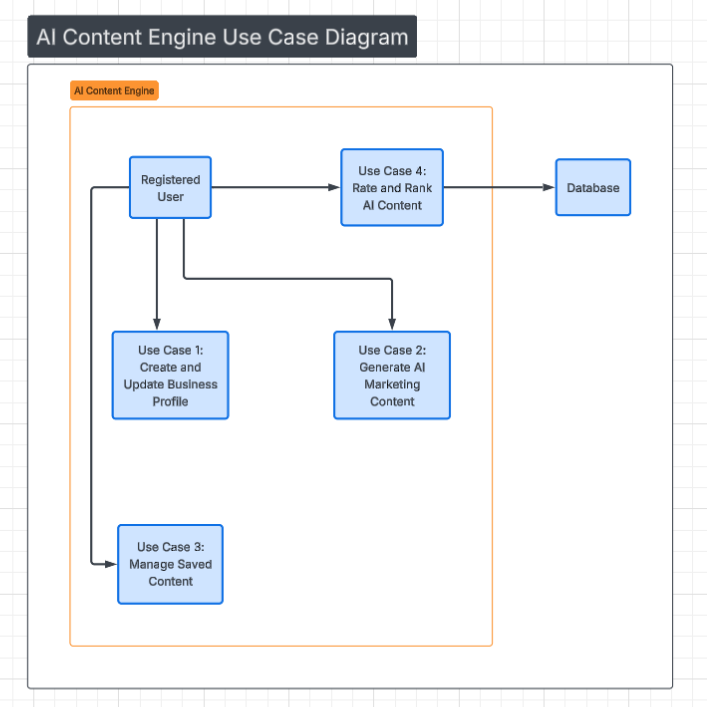

## 4 USE CASE

**Brief Description:** This section describes how the user will interact
with the system step-by-step

### 4.1 Use Case 1: Create and update Business Profile

**Primary Actor:** The registered user

**Pre-conditions:** The user is logged in

**Main flow:**

1.  The user navigates to the Business Profile section.

2.  The user fills in the business name, industry and target audience.

3.  The user chooses a “Brand Tone” from the drop-down list.

4.  The user clicks on “Save Profile.”

**Alternative Flows:** if any mandatory fields are left blank, the
system displays an error message stating “Please fill in all fields.”

### 4.2 Use Case 2: Generate AI Marketing Content

**Brief Description:** This is the main feature where the system
generates content using AI based on the profile provided by the user.

**Actor:** Registered User

**Pre-conditions:** The Business Profile is filled in.

**Main Flow:**

1.  The user chooses a type of content(for example, an Instagram
    caption).

2.  The user clicks the “Generate” button.

3.  The system shows the generated text on the screen.

**Post-conditions:** The content is automatically saved to the dashboard

### 4.3 Use Case 3: Manage Saved Content

**Brief Description:** This will allow the user to see their history of
generated content and remove unwanted entries.

**Actor: Registered User**

**Pre-conditions**: The user must have previously saved content.

**Main Flow:**

1.  The User goes to the “Dashboard” tab.

2.  The system retrieves all saved records for that specific User ID.

3.  The user browses the list and chooses a record to delete.

**Post-conditions**: The record is deleted from the database.

### 4.4 Use Case 4: Rate and improve Al Content

**Brief Description:** This describes exactly how the user interacts
with the rating tool

**Actor:** Registered User

**Pre-conditions**: The content has already been written by the AI, and
it is displayed on the screen.

**Main Flow:**

1.  The user reads the marketing content created by the AI.

2.  The user sees 5 stars displayed below the content.

3.  The user clicks on the **5-star scale** to choose a rating from 1 to
    5 stars.

4.  The system stores the “Star Count” and “Content ID” in the database.

5.  The system calculates a User Satisfaction Score (weighted at 35% of
    the total quality score) to refine future AI generations.

6.  The system automatically saves high-rated content (4 – 5 stars ) to
    the top of the user’s “Top Favourites” list

**Post-conditions**: The user’s rating is stored, the dashboard
re-ranks, and the system updates the paired dataset of automated metrics
and user feedback to improve prompt accuracy for that specific industry.

### 4.5 Use Case Diagram sketch

***5. SEQUENCE DIAGRAM***
