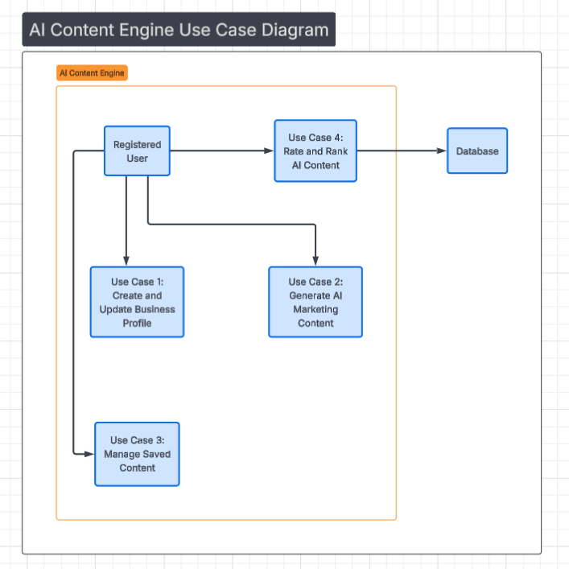

## 4 USE CASE

**Brief Description:** This section describes how the user will interact
with the system step-by-step

### 4.1 Use Case 1: Create and update Business Profile

**Primary Actor:** The registered user

**Pre-conditions:** The user is logged in

**Main flow:**

1.  The user navigates to the Business Profile section.

2.  The user fills in the business name, industry and target audience.

3.  The user chooses a “Brand Tone” from the drop-down list.

4.  The user clicks on “Save Profile.”

**Alternative Flows:** if any mandatory fields are left blank, the
system displays an error message stating “Please fill in all fields.”

### 4.2 Use Case 2: Generate AI Marketing Content

**Brief Description:** This is the main feature where the system
generates content using AI based on the profile provided by the user.

**Actor:** Registered User

**Pre-conditions:** The Business Profile is filled in.

**Main Flow:**

1.  The user chooses a type of content(for example, an Instagram
    caption).

2.  The user clicks the “Generate” button.

3.  The system shows the generated text on the screen.

**Post-conditions:** The content is automatically saved to the dashboard

### 4.3 Use Case 3: Manage Saved Content

**Brief Description:** This will allow the user to see their history of
generated content and remove unwanted entries.

**Actor: Registered User**

**Pre-conditions**: The user must have previously saved content.

**Main Flow:**

1.  The User goes to the “Dashboard” tab.

2.  The system retrieves all saved records for that specific User ID.

3.  The user browses the list and chooses a record to delete.

**Post-conditions**: The record is deleted from the database.

### 4.4 Use Case 4: Rate and improve Al Content

**Brief Description:** This describes exactly how the user interacts
with the rating tool

**Actor:** Registered User

**Pre-conditions**: The content has already been written by the AI, and
it is displayed on the screen.

**Main Flow:**

1.  The user reads the marketing content created by the AI.

2.  The user sees 5 stars displayed below the content.

3.  The user clicks on the **5-star scale** to choose a rating from 1 to
    5 stars.

4.  The system stores the “Star Count” and “Content ID” in the database.

5.  The system calculates a User Satisfaction Score (weighted at 35% of
    the total quality score) to refine future AI generations.

6.  The system automatically saves high-rated content (4 – 5 stars ) to
    the top of the user’s “Top Favourites” list

**Post-conditions**: The user’s rating is stored, the dashboard
re-ranks, and the system updates the paired dataset of automated metrics
and user feedback to improve prompt accuracy for that specific industry.

### 4.5 Exception and alternative flows

The section 4 flows describe the happy path.
These are the ways it does not go that way, and what the system does about each one.
Every row names the requirement it belongs to from section 2.10.

| Flow | Trigger | System response | Requirement |
|---|---|---|---|
| A1 Profile is incomplete | A mandatory profile field is empty or whitespace | The form marks each empty field and does not save | FR-04, FR-07 |
| A2 Industry is not on the list | A value outside the fixed industry list is submitted | The form refuses it and asks for a choice from the list | FR-06 |
| A3 No profile yet | Generate is pressed with no saved profile | 409, with a message that the profile must be created first | FR-07 |
| A4 Not signed in | A protected page or the generate route is reached without a session | A page redirects to the login screen, the route answers 401 | FR-24 |
| A5 Generation already running | A second generate request arrives while one is in flight for that user | 429, one sentence asking the owner to wait, and no second model call | FR-16 |
| A6 Monthly limit reached | The user already has twenty drafts this UTC month | 429, and the dashboard shows the limit with the count | FR-17 |
| A7 AI service fails or times out | Upstream error, network failure, or the thirty second timeout | The route maps the failure to one of four kinds and one status, the form keeps what was typed, and the message is plain | FR-10 |
| A8 AI returns nothing usable | An empty or unreadable response | Treated as a failure, not saved as a draft | FR-10, FR-13 |
| A9 Draft is not the caller's | A draft id belonging to another account is opened | Not found, with no hint that it exists | FR-20, FR-21 |
| A10 Draft is too short to score | An edit leaves fewer than three words | The text is saved, the previous score is kept, and the page says the score was not updated | FR-11, FR-13 |
| A11 Saved template is unusable | An active prompt body no longer names a structure the scorer checks | The row is logged, skipped, and the built-in body is used, and the draft records which one | FR-09 |
| A12 Duplicate submit | The same request identifier arrives twice | The first draft is returned instead of a second model call | FR-13, FR-16 |

Two of these are worth calling out because they were found during the build rather than designed up front: A5, because the browser guard did not survive a second tab, and A10, because saving an edit used to leave a score describing text that no longer existed.

### 4.6 Use Case Diagram sketch

***5. SEQUENCE DIAGRAM***
