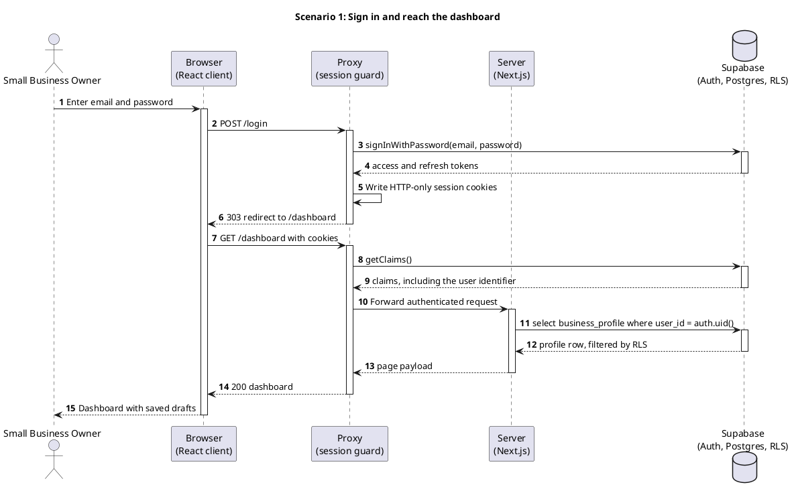
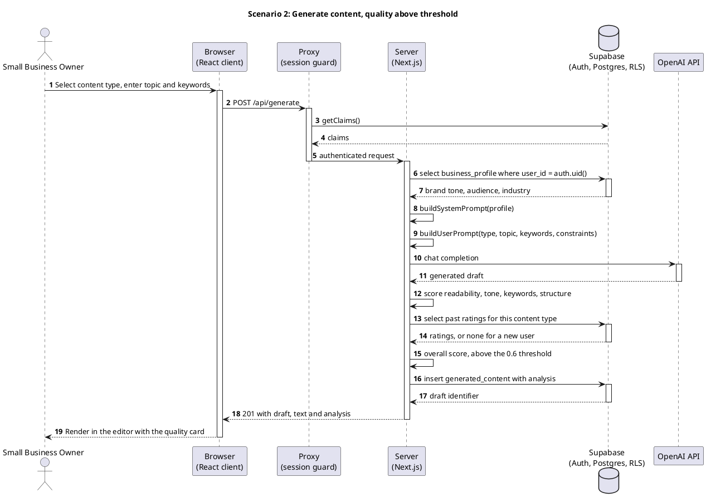
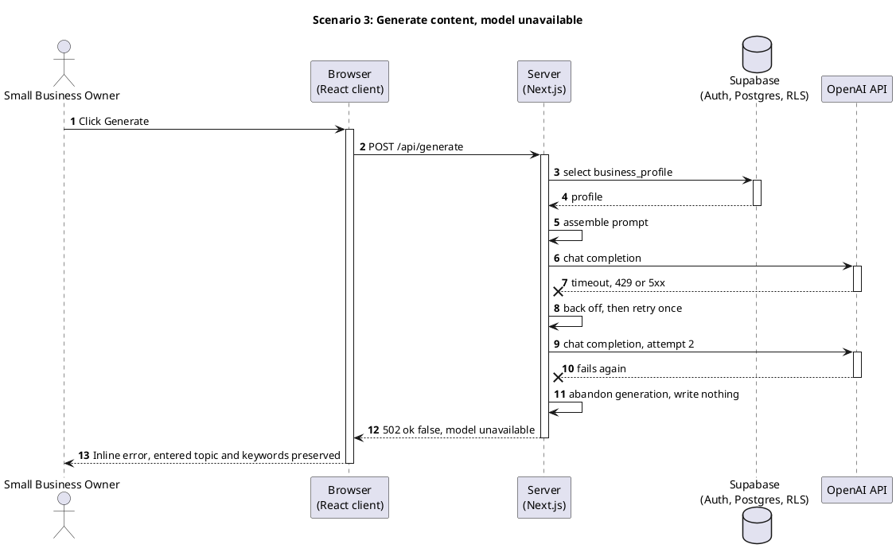
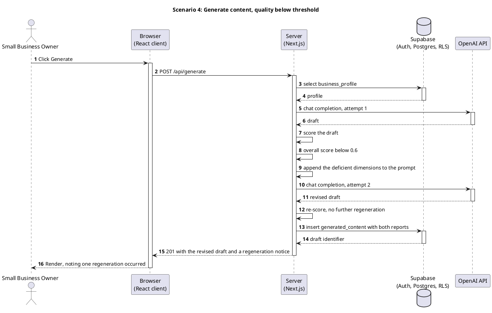
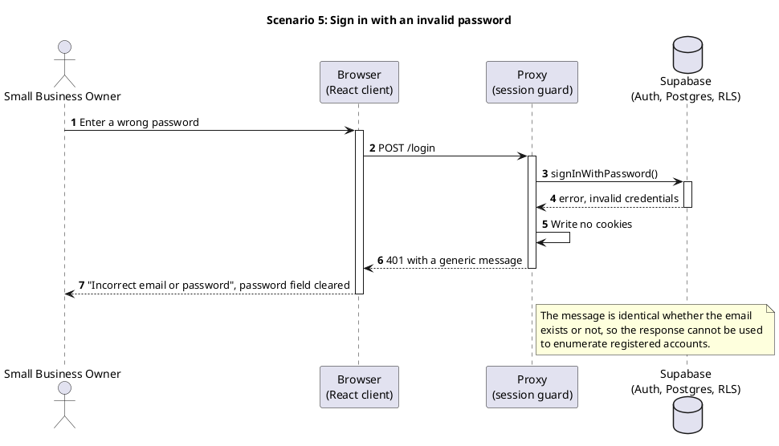

## 5 Sequence Diagrams

### 5.1 Approach

Five diagrams follow, each covering exactly one scenario.

An earlier version of this document combined authentication, generation, evaluation, export and error handling into a single diagram.
That made the failure paths unreadable and hid the trust boundary, because the browser was shown reading the database directly.
Each scenario is now drawn separately, so the success path stays clean and each failure path can be traced on its own.

Actors, participants and their ordering are identical across all five diagrams.
The reader learns the participants once.

Rendered images are inserted after the source below is reviewed, since the previous diagram no longer matches the architecture.

### 5.2 Scenario: Sign in and reach the dashboard

### 5.3 Scenario: Generate content, quality above threshold

### 5.4 Scenario: Generate content, model unavailable

### 5.5 Scenario: Generate content, quality below threshold

### 5.6 Scenario: Sign in with an invalid password

### 5.7 Participants and their implementation

Each participant maps to a module in the repository, so the diagram can be checked against the code.

| Participant | Implementation | Responsibility |
|---|---|---|
| Browser | `app/**/page.tsx`, `components/*.tsx` | Rendering, form state, clipboard and rating interactions |
| Proxy | `proxy.ts` | Session refresh, route guarding, no cookies for unauthenticated requests |
| Server | `app/api/*/route.ts`, Server Components | Authentication check, prompt assembly, model call, scoring, persistence |
| Supabase | `supabase/schema.sql` | Authentication, storage, and row-level security policies |
| OpenAI API | called from `app/api/generate/route.ts` | Text generation only |

### 5.8 Implementation status

Scenarios 1, 2, 3 and 5 correspond to the demonstration build.

Scenario 4 depends on the quality evaluation engine, which is designed in the pseudocode and not yet implemented.
It is scheduled after the demonstration build, because the evaluation requires a working generation pipeline to measure.
Scoring is performed locally from readability, tone, keyword and structural metrics, with historical user ratings read from the database.
No external scoring vendor is used, which removes a dependency that the previous version of this document assumed but never implemented.
