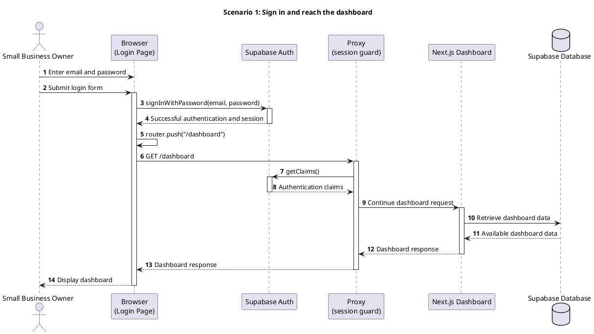
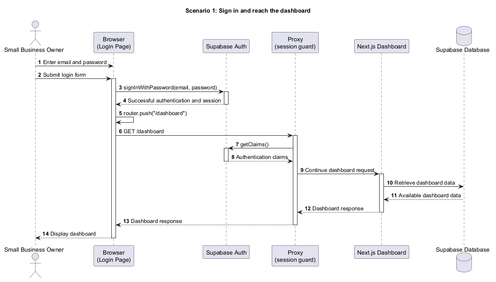
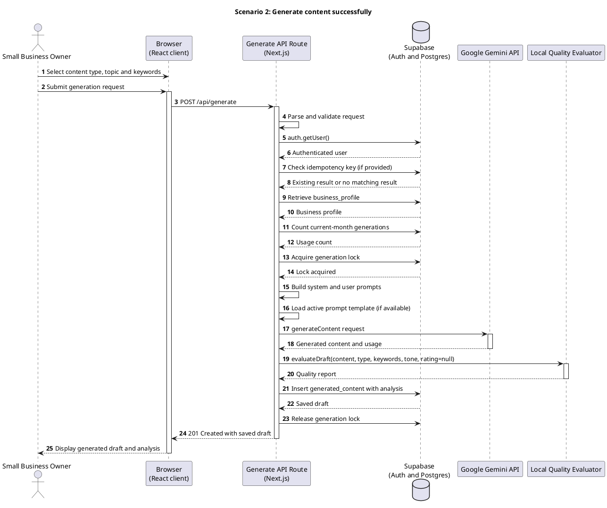
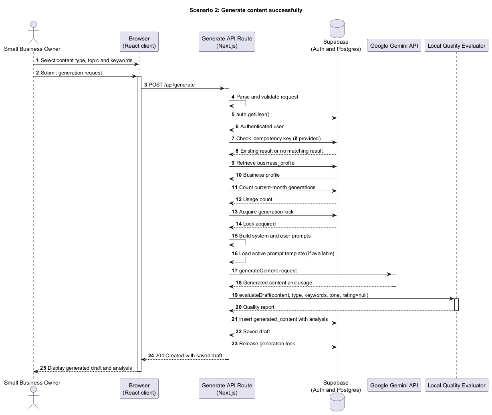
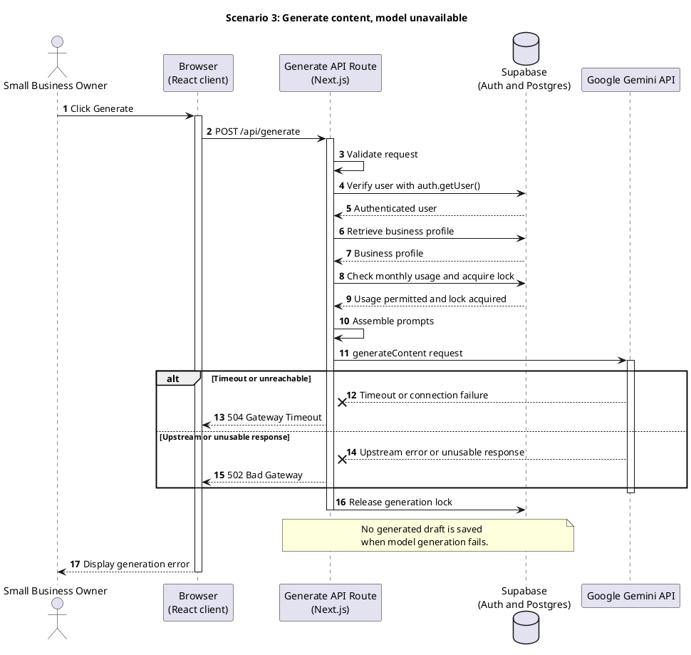
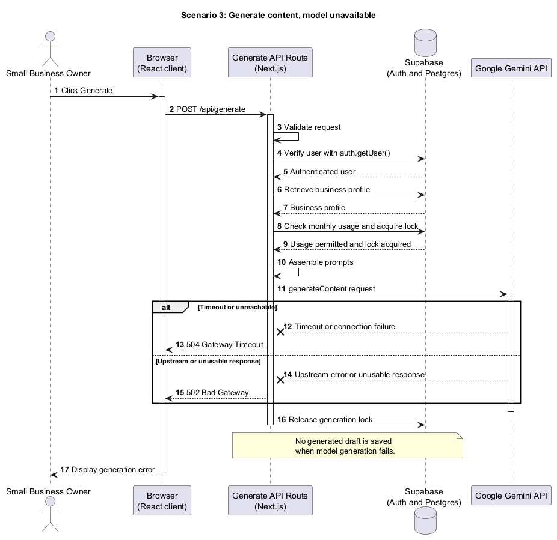
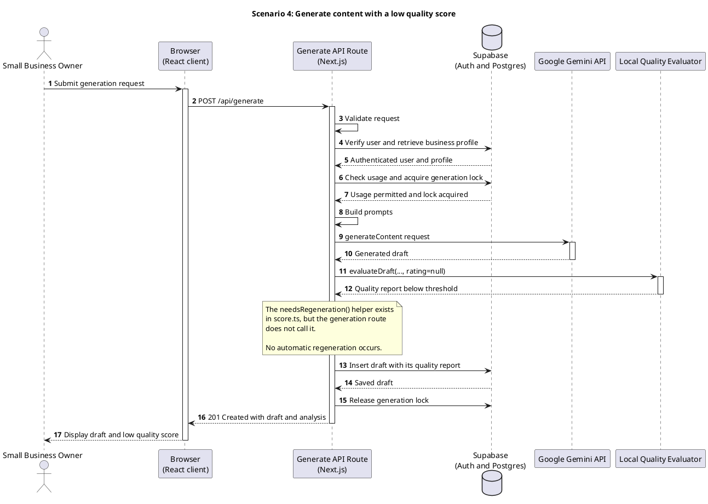
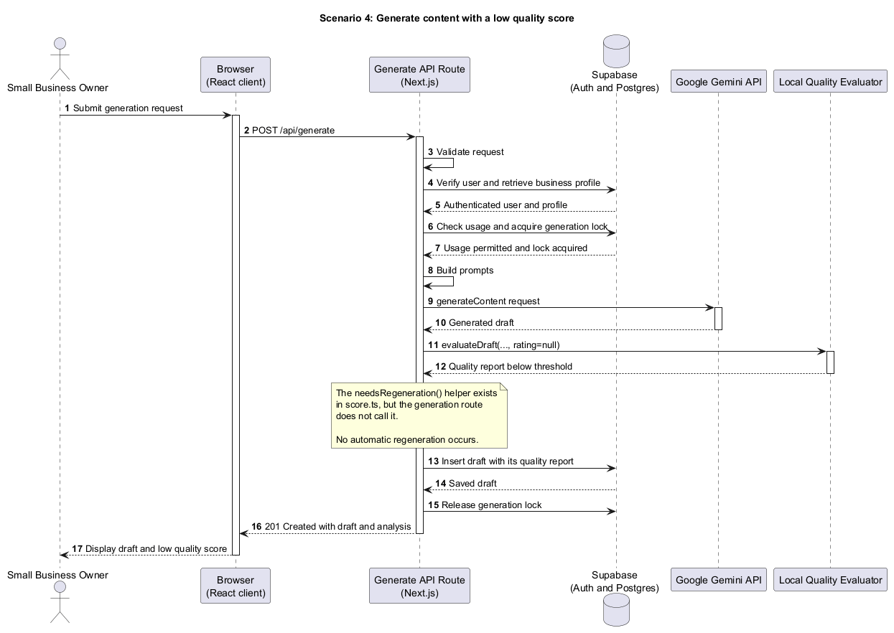
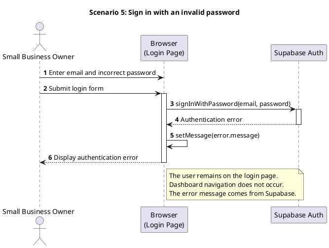
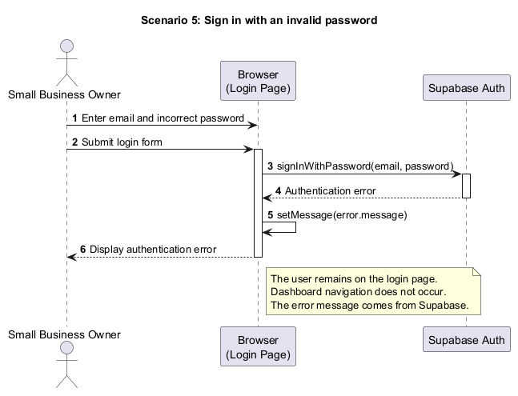


## 5 Sequence Diagrams

### 5.1 Approach

Five diagrams follow, each covering one scenario. The authentication scenarios and content-generation scenarios use the participants relevant to their respective flows.

The diagrams reflect the current implementation in the repository. Authentication is handled by Supabase Auth through the browser client. The generation API independently verifies the user, retrieves the business profile, checks usage limits, calls Google Gemini, evaluates the returned content and saves the result.

The quality evaluator is implemented, but the current generation route does not automatically regenerate content when its score is below the quality threshold. The diagrams therefore show the behaviour that the code actually performs rather than the earlier proposed behaviour.

### 5.2 Scenario: Sign in and reach the dashboard

### 5.3 Scenario: Generate content successfully

### 5.4 Scenario: Generate content, model unavailable

### 5.5 Scenario: Generate content with a low quality score

### 5.6 Scenario: Sign in with an invalid password

### 5.7 Participants and their implementation

Each participant maps to a module in the repository, allowing the diagrams to be checked against the implementation.

| Participant | Implementation | Responsibility |
|---|---|---|
| Browser | `app/**/*.tsx`, `components/*.tsx` | Rendering, form state and user interactions |
| Proxy | `proxy.ts` | Authentication claim checks and protected-route handling |
| Generate API Route | `app/api/generate/route.ts` | Request validation, authentication, usage limits, locking, generation and persistence |
| Supabase | Supabase client and `supabase/schema.sql` | Authentication, database storage and row-level security |
| Google Gemini API | `web/lib/gemini.ts`, `web/lib/generator.ts` | AI text generation |
| Local Quality Evaluator | `web/lib/evaluate.ts`, `web/lib/score.ts` | Readability, tone, keyword, structure and satisfaction scoring |

### 5.8 Implementation status

All five scenarios describe functionality present in, or directly connected to, the current demonstration build.

The login page uses Supabase browser authentication. The proxy checks authentication claims when protected pages are requested. The generation API separately verifies the authenticated user before processing a request.

Content generation uses Google Gemini. After receiving the generated draft, the route calls the local quality evaluator once and stores the resulting analysis with the draft. The evaluator calculates readability, tone alignment, keyword coverage, structural compliance and user satisfaction. During initial generation, the rating is passed as `null`, resulting in a neutral satisfaction score.

The `needsRegeneration()` helper exists in `web/lib/score.ts`, and the quality threshold is defined in the scoring implementation. However, the current generation route does not call this helper. Consequently, a low-scoring draft is not automatically regenerated. If evaluation fails, the route logs the failure and can still save the draft with a null analysis value.

The current implementation does not retry failed Gemini requests. Generation failures return an appropriate error response, and the generation lock is released in the route's cleanup process.

