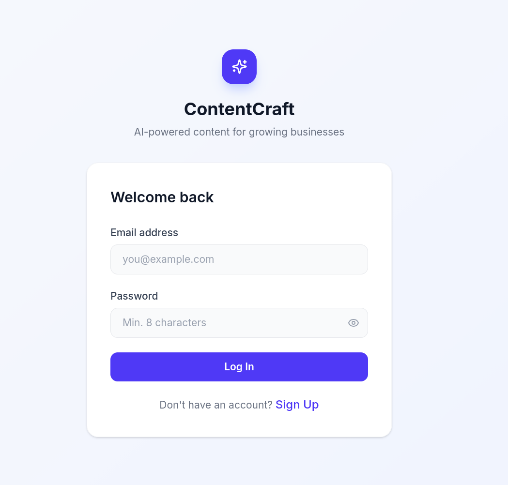
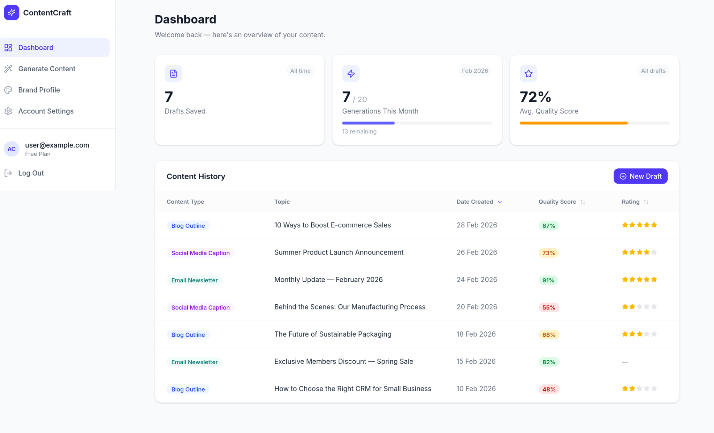
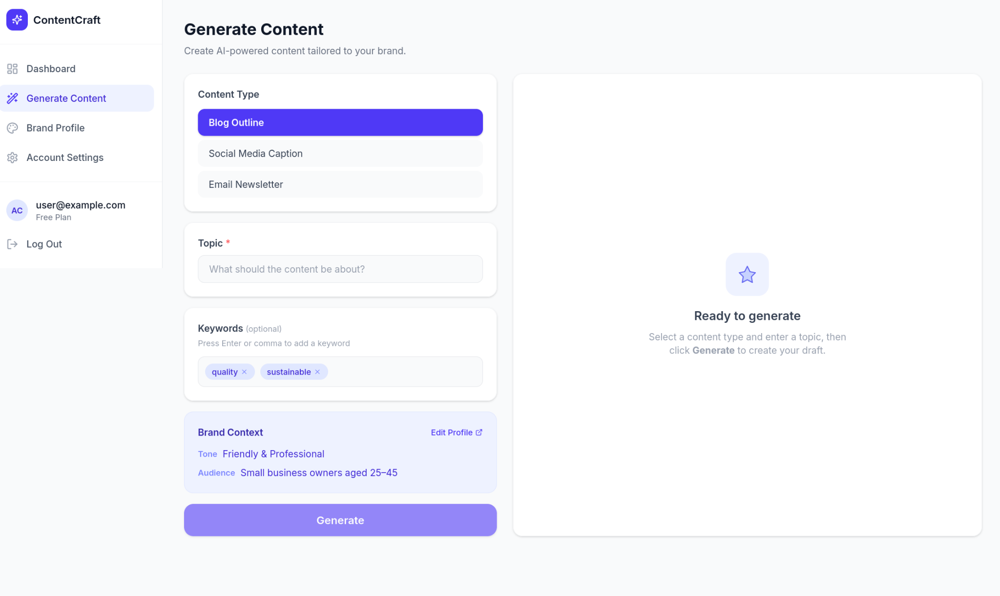

## 7 UI Design

The user interface is designed around three principles drawn from the
project's non-functional requirements: the system must be usable by
non-technical business owners (NFR-05), the core task must be
completable in under 5 clicks after login (NFR-05), and the interface
must be responsive across desktop and tablet devices.

All mockups are created in Figma and follow a consistent design system:
a neutral colour palette with a single accent colour for primary
actions, Inter as the primary typeface, and 8px spacing increments for
layout consistency.

### 7.1 Login Page Design

The login page is the entry point to the platform. It serves two
functions: authenticating existing users and onboarding new ones. The
design prioritises simplicity to avoid creating a barrier to entry for
first-time users.

### 7.2 Dashboard Design

The dashboard is the user's home screen after login. It provides an
at-a-glance view of their saved content and acts as the navigation hub
for the platform.

### 7.3 Content Generator Interface

The Content Generator is the core screen of the application. It is where
the user initiates content creation, reviews AI output, and interacts
with the quality evaluation. This screen must balance simplicity
(non-technical users) with the depth of the generation pipeline (quality
scoring, regeneration, feedback).

