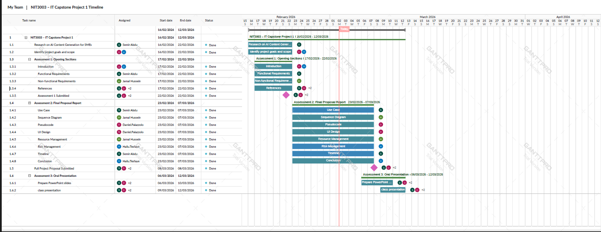
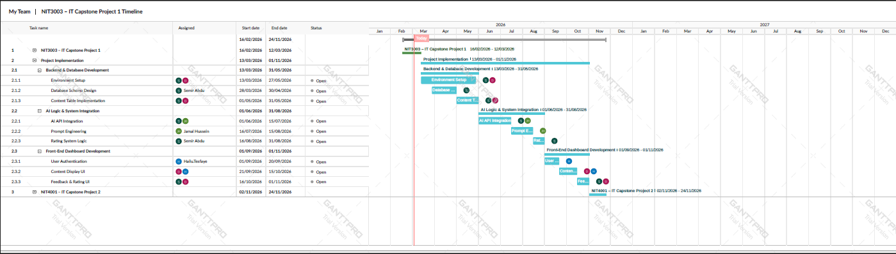
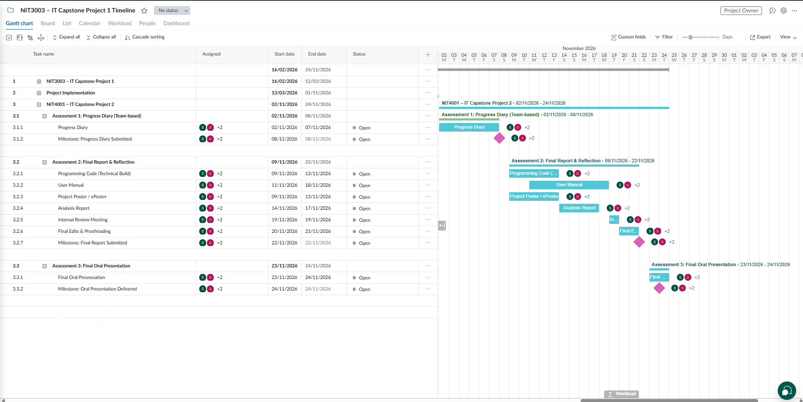

## 10 Timeline & Milestone

The following is a project timetable for the
development of the AI Content Generation Engine, commencing with the
design phase on February 16, 2026 and ending with the project in
November 2026.

### 10.1 NIT3003 – IT Capstone Project 1

At this phase, the "Logic Blueprint" of the AI Content Generation Engine
is addressed, which includes the requirements and design of the AI
Content Generation Engine.

|  |  |  |  |  |  |
|----|----|----|----|----|----|
| **Task ID** | **Component Name** | **Owner(s)** | **Start Date** | **End Date** | **Duration** |
| 1.1 | Research on AI Content Generation | Semir Abdu | 16/02/2026 | 22/02/2026 | 7 Days |
| 1.3.1 | Introduction | Hailu Tesfaye | 17/02/2026 | 22/02/2026 | 6 Days |
| 1.3.2 | Functional Requirements | Semir Abdu | 17/02/2026 | 22/02/2026 | 6 Days |
| 1.3.3 | Non-Functional Requirements | Jamal Hussein | 17/02/2026 | 22/02/2026 | 6 Days |
| 1.4.1 | Use Case Logic | Semir Abdu | 23/02/2026 | 07/03/2026 | 13 Days |
| 1.4.2 | Sequence Diagram | Jamal Hussein | 23/02/2026 | 07/03/2026 | 13 Days |
| 1.4.3 | Pseudocode | Daniel Palazzolo | 23/02/2026 | 07/03/2026 | 13 Days |
| 1.4.4 | UI Design | Daniel Palazzolo | 23/02/2026 | 07/03/2026 | 13 Days |
| 1.4.6 | Risk Management | Hailu Tesfaye | 23/02/2026 | 07/03/2026 | 13 Days |
| 1.4.7 | Timeline & Gantt Setup | Semir Abdu | 23/02/2026 | 07/03/2026 | 13 Days |
| 1.4.8 | Conclusion (Capstone 1) | Hailu Tesfaye | 23/02/2026 | 07/03/2026 | 13 Days |

**NIT3003 – IT Capstone Project 1 Gant Chart**

### 10.2 Project implementation

At this phase, the documentation of the Capstone Project 1 is
transformed into a code and database format.

|  |  |  |  |  |  |
|----|----|----|----|----|----|
| **Task ID** | **Technical Component** | **Owner(s)** | **Start Date** | **End Date** | **Duration** |
| 2.1.1 | Environment Setup | Team | 13/03/2026 | 27/05/2026 | 76 Days |
| 2.1.2 | Database Schema Design | Semir Abdu | 28/03/2026 | 30/04/2026 | 33 Days |
| 2.1.3 | Content Table Implementation | Team | 01/05/2026 | 31/05/2026 | 31 Days |
| 2.2.1 | AI API Integration | Jamal Hussein | 01/06/2026 | 15/07/2026 | 45 Days |
| 2.2.2 | Prompt Engineering | Jamal Hussein | 16/07/2026 | 15/08/2026 | 31 Days |
| 2.2.3 | Rating System Logic | Semir Abdu | 16/08/2026 | 31/08/2026 | 15 Days |
| 2.3.1 | User Authentication | Hailu Tesfaye | 01/09/2026 | 20/09/2026 | 20 Days |
| 2.3.2 | Content Display UI | Daniel Palazzolo | 21/09/2026 | 15/10/2026 | 25 Days |

**Project implementation Gantt chart**

### 10.3 NIT4001 – IT Capstone Project 2

This is the final phase, which includes the benchmarking and the final
oral presentation.

|  |  |  |  |  |  |
|----|----|----|----|----|----|
| **Task ID** | **Assessment Component** | **Owner(s)** | **Start Date** | **End Date** | **Duration** |
| 3.1.1 | Progress Diary | All Members | 02/11/2026 | 07/11/2026 | 6 Days |
| 3.2.1 | Programming Code (Tech Build) | All Members | 09/11/2026 | 13/11/2026 | 5 Days |
| 3.2.3 | Project Poster / ePoster | All Members | 09/11/2026 | 13/11/2026 | 5 Days |
| 3.2.6 | Final Edits & Proofreading | All Members | 20/11/2026 | 21/11/2026 | 2 Days |
| 3.3.1 | Final Oral Presentation | All Members | 23/11/2026 | 24/11/2026 | 2 Days |

**NIT4001 – IT Capstone Project 2 Gant chart**

### 10.4 Contingency Planning

**Logic Buffer:** There is a buffer of one day between Capstone 1
(12/03) and Implementation (13/03) to synchronize the receipt of final
proposal feedback.

**Service Fallback:** The system will fall back to GPT-3.5 Turbo when
the latency of GPT-4 is beyond the performance requirement of 15-45
seconds.

**Database Redundancy:** The team will deploy a PostgreSQL instance when
there is a downtime of Supabase (Task 2.1.2) to continue the development
of the Rating System Logic.
